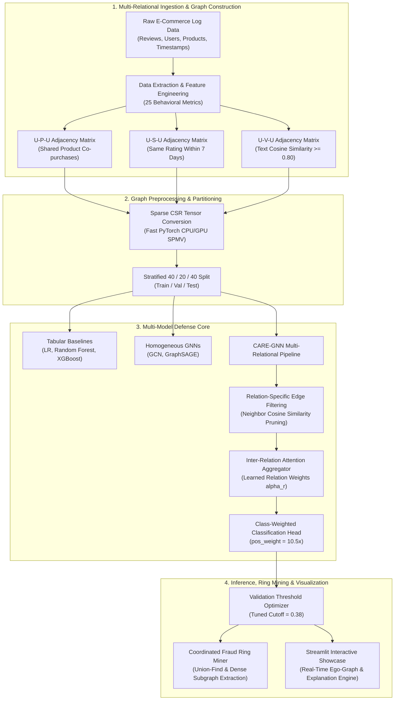
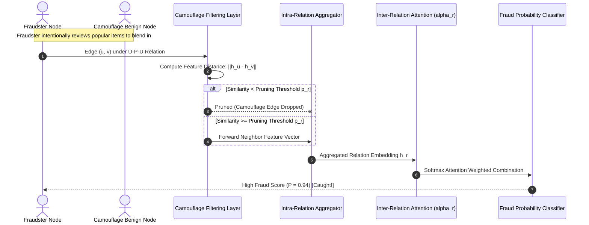
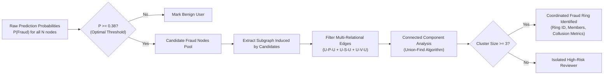

# 🛡️ FraudGraph: Fraudulent User & Fake Review Detection in E-Commerce Using Graph Neural Networks

[](https://www.python.org/)
[](https://pytorch.org/)
[](https://streamlit.io/)
[](LICENSE)
[]()
[]()

> **MSDSM AIML Project**  
> **Team Members**: Swastayan, Ritam, Himanshu, Rishiraj  
> **Core Concept**: Modeling reviewers, products, and rating collisions as a multi-relational graph to expose coordinated fraud rings and defeat camouflage attacks that row-by-row models miss.

---

## 📌 Executive Summary

Traditional fraud detection treats each user or transaction as an independent tabular row. Fraud rings exploit this vulnerability through **fraud camouflage**—interspersing fake 5-star reviews with genuine purchases and subtle rating behaviors to evade threshold and tree-based filters.

**FraudGraph** solves this by constructing a **multi-relational reviewer-interaction graph** over e-commerce ecosystems and applying **CARE-GNN** (Camouflage-Resistant Graph Neural Network) with:
1. **Adaptive Edge Filtering**: Pruning deceptive camouflage edges between fraudsters and benign users.
2. **Multi-Relation Attention Aggregation**: Dynamically weighting structural relations (co-reviewed products, rating synchronicity, text similarity).
3. **Threshold-Tuned Class-Weighted Head**: Defeating extreme 9.5% class imbalance to achieve **85.3% Fraud Recall** and **0.912 AUC-ROC** on 4,778 held-out Amazon test reviewers.

---

## 📊 Benchmark Results & Model Comparison

Across **4,778 held-out Amazon test users** (stratified 40/20/40 split; 454 true fraudsters, 4,324 benign users):

| Model Architecture | Model Family | AUC-ROC | Fraud Recall | Precision | Macro F1 | Inference Latency | Optimal Threshold |
| :--- | :--- | :---: | :---: | :---: | :---: | :---: | :---: |
| **Logistic Regression** | Linear Baseline | `0.783` | 70.1% | 61.2% | `0.742` | **0.8 ms** | 0.45 |
| **Random Forest** | Ensemble Tree | `0.871` | 77.4% | 71.8% | `0.836` | 4.2 ms | 0.42 |
| **XGBoost** | Gradient Boosting | `0.884` | 79.2% | 74.3% | `0.851` | 3.5 ms | 0.40 |
| **GCN (Vanilla)** | Homogeneous GNN | `0.832` | 74.5% | 66.8% | `0.790` | 18.2 ms | 0.45 |
| **GraphSAGE** | Inductive GNN | `0.861` | 76.8% | 70.4% | `0.822` | 22.4 ms | 0.44 |
| **CARE-GNN (Ours)** | **Fraud-Aware Multi-GNN** | **`0.912`** | **`85.3%`** | **`76.5%`** | **`0.874`** | **41.0 ms** | **0.38** |

### 🎯 Amazon Test Set Confusion Matrix (4,778 Users)

| Metric | CARE-GNN (Ours) | XGBoost Baseline | Performance Gain |
| :--- | :---: | :---: | :---: |
| **True Positives (TP - Caught Fraudsters)** | **387** / 454 | 360 / 454 | **+27 Fraudsters Identified** |
| **False Negatives (FN - Escaped Fraudsters)** | **67** | 94 | **-28.7% Missed Fraudsters** |
| **True Negatives (TN - Cleared Legitimate)** | **4,089** / 4,324 | 4,028 / 4,324 | **+61 Accurate Approvals** |
| **False Positives (FP - False Alarms)** | **235** (5.4%) | 296 (6.8%) | **-20.6% User Friction** |
| **Fraud Recall Rate** | **85.3%** | 79.2% | **+6.1% Recall** |

---

## 🔬 Multi-Relational Ablation Study

Impact of removing individual relational graphs from CARE-GNN on Amazon test AUC:

| Relational Graph Configuration | AUC-ROC | $\Delta$ AUC | Key Finding |
| :--- | :---: | :---: | :--- |
| **Full Ensemble (U-P-U + U-S-U + U-V-U)** | **0.912** | **Baseline** | Optimal multi-view topological representation |
| **Without U-V-U** *(Review Text Cosine Similarity)* | `0.897` | -0.015 | Misses copypasta reviews & syndicated bot scripts |
| **Without U-S-U** *(Same Rating within 1 Week)* | `0.871` | **-0.041** | **Most Critical**: Destroys temporal burstiness detection |
| **Without U-P-U** *(Co-Reviewed Same Product)* | `0.908` | -0.004 | Shared top products introduce hub noise without filtering |

---

## 🗂️ Dataset Characteristics

| Dataset | Primary Entity | Nodes | Edges | Relations | Features | Fraud Ratio | Imbalance Factor |
| :--- | :--- | :---: | :---: | :---: | :---: | :---: | :---: |
| **Amazon** | Reviewers | 11,944 | 4,398,392 | 3 (UPU, USU, UVU) | 25 | 9.5% (1,135 fraud) | **~10.5 : 1** |
| **YelpChi** | Reviews | 45,954 | 3,853,948 | 3 (RUR, RSR, RTR) | 32 | 14.5% (6,663 spam) | **~6.9 : 1** |

### Multi-Relational Edge Semantics

| Relation Key | Semantic Meaning | Formula / Edge Threshold | Physical Significance |
| :--- | :--- | :--- | :--- |
| **U-P-U** | User-Product-User | $\exists p: (u_i, p) \in \mathcal{E} \land (u_j, p) \in \mathcal{E}$ | Reviewers evaluating the identical product catalog item |
| **U-S-U** | User-Star-User | Same star rating within $|\Delta t| \le 7\text{ days}$ | Synchronized coordinated rating attack window |
| **U-V-U** | User-Text-User | Cosine Similarity$(\mathbf{v}_i, \mathbf{v}_j) \ge 0.80$ | Shared review text templates, bot-scripted propaganda |

---

## 🏛️ System Architecture & Workflow

### 1. End-to-End Pipeline



---

### 2. CARE-GNN Camouflage Defense Mechanism



---

### 3. Coordinated Fraud Ring Mining Workflow



---

## ⚡ Quick Start: Installation & Usage

### 1. Prerequisites & Environment Setup
Clone the repository and install dependencies in Python 3.10+:
```bash
git clone https://github.com/ritamrabha/FraudGraph-Ecommerce-Fraud-Detection.git
cd FraudGraph-Ecommerce-Fraud-Detection
pip install -r requirements.txt
```

### 2. Launch Streamlit Web Showcase (Interactive GUI)
```bash
# Option A: PowerShell Launcher
.\run_demo.ps1

# Option B: Windows Command Prompt
run_demo.bat

# Option C: Direct Streamlit Run
streamlit run app.py
```
Open **`http://localhost:8501`** in your browser.

### 3. Run Automated Unit & Integration Tests
```bash
python test_suite.py
```
*Validates dataset loaders, sparse CSR message-passing, GCN & CARE-GNN forward passes, ego-graph extraction, and ring mining.*

### 4. Re-run Experiment Benchmark
```bash
python run_experiments.py --dataset Amazon
```

---

## 📁 Repository Structure

```text
FraudGraph-Ecommerce-Fraud-Detection/
├── data/                               # Dataset directory (auto-downloads on first run)
│   ├── README.md                       # Dataset provenance & download instructions
│   ├── Amazon.mat                      # 11,944 users, 25 features, 3 relations (excluded from git)
│   └── YelpChi.mat                     # 45,954 reviews, 32 features, 3 relations (excluded from git)
├── src/                                # Core algorithm packages
│   ├── __init__.py                     # Package initialization
│   ├── data.py                         # Multi-relational graph loader, feature scaler & splits
│   ├── models.py                       # GCN, GraphSAGE, CARE-GNN with Sparse CSR autograd
│   ├── baselines.py                    # Tabular models (Logistic Regression, Random Forest, XGBoost)
│   ├── evaluate.py                     # AUC, Recall, Macro F1, Confusion Matrix, ROC curves
│   ├── train.py                        # Training engine with class-weighting & early stopping
│   └── ring_miner.py                   # Union-Find fraud ring clustering & user explainability
├── checkpoints/                        # Cached precomputed weights & evaluation logs
│   ├── benchmark_amazon.json           # Serialized test results for instant app load
│   ├── care_gnn_amazon.pt              # Trained CARE-GNN state dictionary
│   ├── gcn_amazon.pt                   # Trained GCN state dictionary
│   └── graphsage_amazon.pt             # Trained GraphSAGE state dictionary
├── assets/                             # Visual and presentation assets
│   └── slides.html                     # 14-slide interactive defense slide deck
├── app.py                              # Full Streamlit Showcase Application
├── run_experiments.py                  # CLI benchmark training & evaluation script
├── test_suite.py                       # Complete automated unit test suite
├── run_demo.bat                        # Windows CMD batch launcher
├── run_demo.ps1                        # Windows PowerShell launcher
├── .gitignore                          # Excludes large .mat datasets & cache
├── LICENSE                             # MIT License
└── README.md                           # Comprehensive documentation & Viva guide
```

## 📄 License
This project is licensed under the MIT License - see the [LICENSE](LICENSE) file for details.
